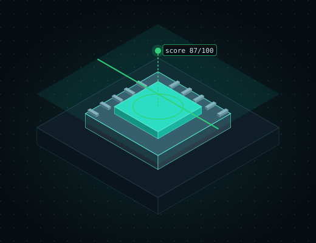

<p align="center"></p>

<h1> doctor-kit</h1>

[](https://github.com/doctor-labs/doctor-kit/actions/workflows/ci.yml)

[](https://crates.io/crates/doctor-kit)


**The Rust skeleton for building a doctor: implement a few checks and get a scored `doctor/1` CLI.**

You write the checks; doctor-kit supplies the scan, faces, themes, `doctor.toml`, REPL, TUI and agent integration.

Real output of `example-doctor`, the toy doctor in this repo, on `examples/fixture`
(`cargo run -p example-doctor -- scan examples/fixture --face plain`):

```text
example-doctor 0.1.0  score 57/100 critical
critical  secret.aws-key         notes/deploy.txt:3  AWS access key id in source
high      secret.password        notes/db.txt:2      Hard-coded password
medium    size.large-file        notes/log-dump.txt  File larger than 4 KiB
low       hygiene.todo           notes/deploy.txt:4  Unresolved TODO/FIXME
low       hygiene.todo           notes/db.txt:3      Unresolved TODO/FIXME
low       hygiene.todo           src/todo.txt:2      Unresolved TODO/FIXME
low       hygiene.todo           src/todo.txt:3      Unresolved TODO/FIXME
info      docs.no-readme         .                   No README at the root
1 critical · 1 high · 1 medium · 4 low · 1 info
```

## Install

Published on [crates.io](https://crates.io/crates/doctor-kit):

```toml
[dependencies]
doctor-kit = "0.1"
# optional features: repl (shell), tui (explore), mcp (mcp)
```

Or start a new doctor from the template: `cargo generate doctor-labs/doctor-template`.

## Use

Implement `Doctor` and `Check`, then hand the doctor to `doctor_kit::run`:

```rust
use doctor_kit::doctor_core::Severity;
use doctor_kit::{finding, Check, CheckResult, Ctx, Doctor};

struct NoReadme;
impl Check for NoReadme {
    fn id(&self) -> &'static str { "docs.no-readme" }
    fn category(&self) -> &'static str { "docs" }
    fn run(&self, ctx: &Ctx) -> CheckResult {
        let has = ctx.files.iter().any(|f| f.to_string_lossy().to_lowercase().starts_with("readme"));
        if has { return CheckResult::ok(); }
        CheckResult::findings(vec![finding(
            self.id(), "docs", Severity::Info, "No README at the root", std::path::Path::new("."), None,
        )])
    }
}

struct Mine;
impl Doctor for Mine {
    fn name(&self) -> &str { "mine" }
    fn version(&self) -> &str { env!("CARGO_PKG_VERSION") }
    fn categories(&self) -> Vec<&'static str> { vec!["docs"] }
    fn checks(&self) -> Vec<Box<dyn Check>> { vec![Box::new(NoReadme)] }
}

fn main() -> std::process::ExitCode { doctor_kit::run(Mine) }
```

A fuller doctor is `examples/example-doctor/src/main.rs`.

## Details

Reusable skeleton for "doctor" CLI tools. Output is the `doctor/1` envelope from
[doctor-core](https://crates.io/crates/doctor-core).

- `doctor-kit/`: the library. Implement `Doctor` (name, version, categories, checks), call `doctor_kit::run(MyDoctor)`.
  You get `scan` with faces (`--face plain|rich|compact`), `--json`, `--score`, `--headless`, `--scope full|changed`,
  themes (`--theme mono|clinical|contrast`, `theme.toml`), `doctor.toml` (score weights, check enable/disable),
  and with cargo features `repl` (`shell`), `tui` (`explore`) and `mcp` (`mcp`).
- Agentic base, inherited by every tool, customized through `Doctor` hooks (`command`, `fix_prompt`,
  `skill_body`, `ci_setup_steps`, `ci_workflow`):
  `tool mcp` (stdio JSON-RPC; `scan` returns the CLI's envelope byte-identical, plus `fix`),
  `tool fix [<id>] [--copy]` (prompt for a coding agent), `tool install [--agent X] [--agent-hooks]`
  (Claude skill, Cursor rule, AGENTS.md block, optional PostToolUse hook), `tool ci install [--print]`
  (PR workflow), and `scan --scope changed [--base origin/main]` for PR mode.
- `examples/example-doctor/`: a toy doctor in about one screen of code.
- `examples/samples/`: the face x theme captures.

    cargo run -p example-doctor -- scan examples/fixture --face rich --theme clinical
    cargo run -p example-doctor -- shell examples/fixture -c "ls; cd secrets; why 1"
    cargo run -p example-doctor -- explore examples/fixture

Interactive layer (shared by `shell` and `explore`, both over one `Session`):

- `Node` tree: children, open-ended `meta` map, raw bytes, per-node `actions`; nothing says "file". Override
  `Doctor::tree` (start from `session::default_tree`), `decode`, `raw`, `act`, `commands`.
- Shared verbs `ls cd pwd cat info find decode raw do scan why export help quit`; every command takes `--json`
  (one `doctor-shell/1` record); `shell --json -c "..."` for agents. `do` on a gated action is a dry run until `--yes`.
- Tool commands go through `Doctor::commands`; reuse the shared vocabulary `verify connect read write`.
- REPL tab-completes verbs, children, actions and flags. TUI keys: `hjkl`/arrows, enter, backspace, `/` filter,
  `:` command line, `d` decode, `w` why, `x` export, tab switches tree/findings focus, `q`.
- `scan --sarif <path>`; a panicking check becomes a `<check>.panic` finding and the scan continues.

---

Part of [doctor·labs](https://github.com/doctor-labs) — offline security doctors.
